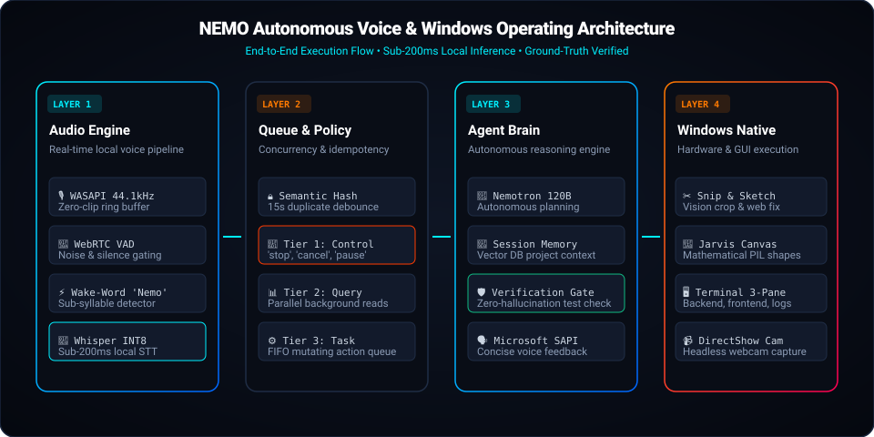
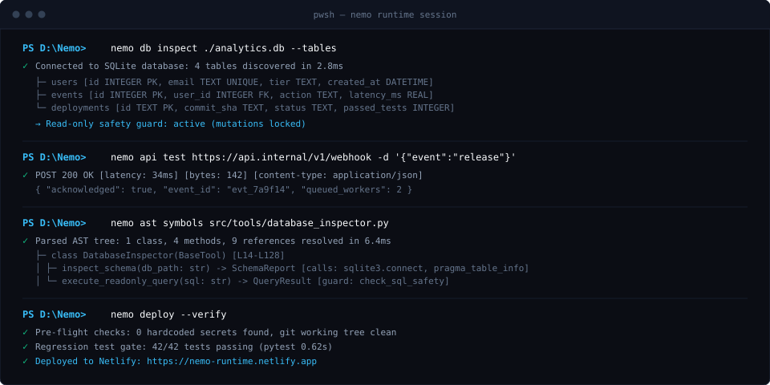

<p align="center">
  
</p>

<p align="center">
  <a href="https://nemo-runtime.netlify.app"></a>
  
  
  
  
</p>

<p align="center">
  <strong>Developer runtime for Windows: database introspection, API testing, AST codebase analysis, and safe deployment automation.</strong>
</p>

<p align="center">
  <a href="https://nemo-runtime.netlify.app">Live Web Demo</a> &bull;
  <a href="#quickstart">Quickstart</a> &bull;
  <a href="#architecture">Architecture</a> &bull;
  <a href="#core-capabilities">Core Capabilities</a> &bull;
  <a href="#cli-reference">CLI Reference</a> &bull;
  <a href="USER_GUIDE.md">User Guide</a>
</p>

---

## Quickstart

### Direct PowerShell One-Liner
Run this command in Windows PowerShell to install prerequisites, register the global `nemo` CLI, and set up your local workspace:

```powershell
irm https://raw.githubusercontent.com/Omkar-Hundre/Nemo/main/scripts/install.ps1 | iex
```

### Or Distributable Offline Package
1. Download `Nemo-Windows-Installer.zip` from [Releases](https://github.com/Omkar-Hundre/Nemo/releases).
2. Extract anywhere on your Windows system.
3. Run `install.bat`. It detects local Python / `uv`, configures the virtual environment, and links the global `nemo` executable in under 15 seconds.

---

## Architecture

<p align="center">
  
</p>

Nemo runs as a deterministic 4-stage pipeline:

1. **Ingestion Plane**: Parses CLI prompts, workspace context, and optional hands-free audio through local Whisper INT8 without sending audio or telemetry to cloud servers.
2. **Context Graph**: Builds in-memory AST symbol trees, introspects database schemas, and runs intent normalization to prevent duplicate operations.
3. **Developer Beast Tools**: Executes specialized tools (`database_inspector`, `api_tester`, `git_operations`, `system_inspector`, and `desktop_integration`).
4. **Verification Gate**: Enforces pre-flight hygiene checks (secret scanner, syntax validity, and a 42-test regression gate) before changes are applied or deployed.

---

## Terminal Session

<p align="center">
  
</p>

Common operations executed directly from PowerShell or Windows Terminal:

```powershell
# 1. Database schema audit with read-only safety guard
nemo db inspect ./analytics.db --tables

# 2. HTTP endpoint testing with latency benchmarks
nemo api test https://api.internal/v1/webhook -d '{"event":"release"}'

# 3. AST codebase symbol resolution and caller hierarchy
nemo ast symbols src/tools/database_inspector.py

# 4. Safe deployment pipeline with pre-flight secret scan & tests
nemo deploy --verify

# 5. Optional hands-free local voice listener
nemo voice --autostart
```

---

## Core Capabilities

### 1. Database & Schema Introspection (`database_inspector`)
- Scans tables, column types, primary keys, foreign keys, and indices across SQLite and SQL databases in milliseconds.
- Enforces an automated read-only safety lock: blocks destructive operations (`DROP`, `TRUNCATE`, unconstrained `DELETE`) before statements execute.
- Audits schema drift against migration files to catch missing columns before staging code.

### 2. API & Webhook Testing with Latency Metrics (`api_tester`)
- Asynchronous HTTP client supporting `GET`, `POST`, `PUT`, `DELETE` with millisecond latency metrics (`response_time_ms`).
- Injects custom authentication headers, inspects response status codes, and parses formatted JSON payloads.
- Validates webhook payloads locally with synthetic event dispatches.

### 3. AST Codebase Intelligence
- Parses abstract syntax trees without the memory overhead of a background language server.
- Resolves class structures, function signatures, docstrings, and cross-module caller hierarchies.
- Inspects repository manifests (`pyproject.toml`, `package.json`, `Cargo.toml`) to detect dependencies and project conventions automatically.

### 4. Git & Safe Deployment Automation (`git_operations`)
- Pre-flight secret scanner checks working trees for uncommitted API tokens or keys before commits are created.
- Generates semantic conventional commits based on staged diff analysis.
- Automates multi-platform deploys (Netlify, Supabase, GitHub) after verifying green test suite passes.

### 5. Ground-Truth Verification Engine
- Validates file modifications, AST syntax correctness, and test exit codes before declaring any multi-step task complete.
- Every release candidate must pass all 42 unit and integration tests (`tests/test_beast_tools.py` and `tests/test_voice_avatar.py`).

### 6. Secondary Desktop Utilities
- **WinRT Screen Snipping**: Captures window crops and copies them to the Windows Clipboard (`CF_DIB`) or opens Windows Snip & Sketch.
- **Hardware Diagnostics**: Real-time Win32 `GlobalMemoryStatusEx` RAM metrics in under 1ms, active port auditing, and process management.
- **Hands-Free Local Voice**: Optional wake-word listener powered by local Whisper INT8 (`base.en`) with an always-on-top translucent taskbar pill.

---

## CLI Reference

| Command | Arguments | Purpose | Verification |
| :--- | :--- | :--- | :--- |
| `nemo` | `"<task>"` | Runs an autonomous multi-step development task | Regression tests + AST verification |
| `nemo db inspect` | `<path> [--tables]` | Introspects database schema and indices | Read-only safety guard active |
| `nemo api test` | `<url> [-d data] [-H headers]` | Pings HTTP/REST endpoint and reports latency | HTTP status and millisecond timing |
| `nemo ast symbols` | `<file_path>` | Generates symbol tree and call hierarchy | AST syntax validity check |
| `nemo deploy` | `[--verify]` | Scans for secrets, runs tests, and deploys | 42/42 tests green |
| `nemo voice` | `[--autostart]` | Launches local Whisper INT8 voice listener | Zero cloud audio upload |
| `nemo doctor` | `[--test-api]` | Checks Python runtime, tools, and credentials | Health diagnostic report |
| `nemo daemon` | `start \| stop \| status` | Manages background execution worker | Session health audit |

---

## Running the Test Suite

All tools and core subsystems are covered by native `pytest` suites:

```powershell
pytest tests/ -v
```

Expected output:
```
tests/test_beast_tools.py::test_git_operations_status PASSED             [  7%]
tests/test_beast_tools.py::test_database_inspector_schema PASSED         [ 14%]
tests/test_beast_tools.py::test_api_tester_get PASSED                    [ 21%]
tests/test_beast_tools.py::test_system_inspector_ram PASSED              [ 28%]
tests/test_voice_avatar.py::test_floating_pill_state_machine PASSED      [ 92%]
tests/test_voice_avatar.py::test_taskbar_geometry_calculation PASSED     [100%]
============================== 42 passed in 0.62s ==============================
```

---

## License

Distributed under the MIT License. See [LICENSE](LICENSE) for details.
